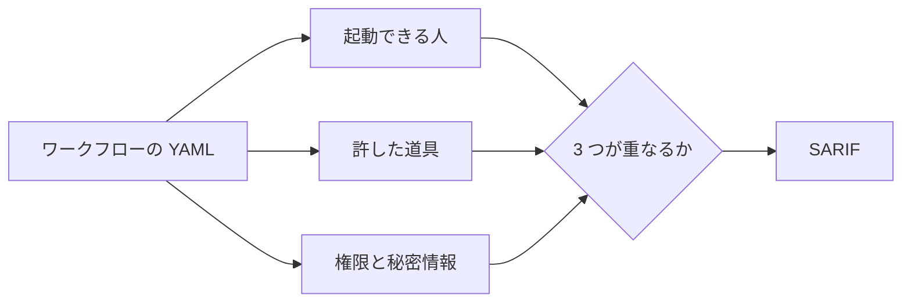

# 0001. AI コーディングエージェントを動かす GitHub Actions のワークフローを、起動できる人・許した道具・権限の重なりで静的に検査する

- ステータス: 承認
- 日付: 2026-11-08

## 文脈

- AI コーディングエージェントを GitHub Actions で動かし、issue やコメントを読ませて、PR やコメントを書かせる使い方が広がった。Claude Code、Codex、Gemini CLI は、それぞれ公式の Action を出している
- 2026 年に、CI で動くエージェントから秘密情報が抜かれる事件が続いた
  - 2026-04、PR のタイトル 1 つに埋めた指示で、3 つのコーディングエージェントが runner の環境変数にある API キーを PR のコメントに書き出した([VentureBeat の報道](https://venturebeat.com/security/ai-agent-runtime-security-system-card-audit-comment-and-control-2026))
  - 2026-08 の Black Hat で、リポジトリの権限を持たないアカウントが立てた issue から、Claude Code、Gemini CLI、Codex の CI の秘密情報に届くと報告された([VentureBeat の報道](https://venturebeat.com/security/ai-agent-runtime-security-system-card-audit-comment-and-control-2026)と [Cloud Security Alliance の研究ノート](https://labs.cloudsecurityalliance.org/research/csa-research-note-ai-coding-agent-cicd-secrets-20260808-csa/))
  - Cloud Security Alliance は、CI のエージェントは、エージェントが読む内容を書ける誰にでもさらされていると扱い、長く使える鍵を短命で範囲の狭い鍵に替えるよう勧めている
- 各社の Action の公式文書は、危ない設定をはっきり警告している(ADR 0003)。ところが、自分のワークフローがその警告に当たっていないかを確かめる道具は見つからなかった
  - GitHub Actions の静的検査の定番の zizmor は、危ないトリガーとテンプレート注入を見るが、[リリースノート](https://github.com/zizmorcore/zizmor/blob/main/docs/release-notes.md)(1.32.0 と未リリースの分、2026-11-08 に確認)にエージェント向けの検査は無い
  - [GitHub Agentic Workflows(gh-aw)](https://github.github.com/gh-aw/reference/safe-outputs/)は、エージェントには読むことだけをさせ、書き込みは権限を分けた別のジョブに任せる作りを持つ。ただし、276 のリポジトリから集めた 1,248 件の gh-aw の設定のうち、人手で分類した 288 件で、指示の注入への備えに触れていたのは 9.4%(約 27 件)だった。分類したのは本文だけで、frontmatter に書いた守りは数えていない(2026-09 に arXiv に出た論文を紹介した[記事](https://www.matthewswong.com/en/blog/gh-aw-empirical-study-prompt-injection-gap/)による)
- 作り手は一人。世の中の需要を調べて OSS の案を 11 個出し、OSS の利用者兼メンテナー、開発者向けツールの市場の分析者、個人開発の技術メンターの 3 つの立場で独立に採点した(1 人 20 点、3 人で 60 点)。採点したのは実在の人ではなく、同じ資料だけを渡して立場を演じさせた Claude のサブエージェントで、互いの点も Claude の採点も見せていない。上位の 5 案は次のとおり

| 案 | 合計 |
|---|---|
| G AI エージェントを動かす GitHub Actions の検査器 | 44 |
| B OSS メンテナー向けの PR 受付係(AI が作った質の低い PR の仕分け) | 44 |
| I 日本語の文書読み取りの公開ベンチマーク | 40 |
| D LLM の費用の増え方を PR ごとに止める | 39 |
| J 日本のデジタルインボイス(JP PINT)の Python ライブラリ | 39 |

## 検討した選択肢

1. G を作る
2. B を作る
3. I を作る
4. D か J を作る

## 決定

高橋さんが 1 を選んだ。名前は sekimori(関守、関所の番人)にした。

- ワークフローの YAML を読むだけの静的検査にする。ワークフローを動かさず、LLM も使わない
- 判定は 1 行の設定ではなく、次の 3 つの重なりで行う。どれか 1 つだけなら使い方しだいだが、3 つが重なると 2026 年の事件と同じ形になる
  - 起動できる人: ワークフローのトリガー(`issue_comment`、`issues`、`pull_request_target` など)と、Action の起動できる人の設定
  - 許した道具: シェル、ファイルの書き込み、ネットワークなど、エージェントに許した道具の広さ
  - 権限と秘密情報: ジョブの `permissions`、エージェントに渡すトークンの種類、環境変数の秘密情報
- CLI と GitHub Action の両方で配る。結果は SARIF で出し、GitHub のコードスキャンに載せられるようにする

## 理由

- 同じことをする道具が見つからず、検査の根拠を各社の公式文書と報告された事件に置ける
- LLM を使わず、コードも外に送らないので、使う人に費用がかからず、作り手も一人で保守できる
- 効き目を費用なしで示せる。公開リポジトリのワークフローに当て、3 つが重なった件数を数えればよい
- B は、GitHub の公式機能(2026-02 の PR の無効化と協力者だけへの制限、2026-06 の書き込み権限の無い人が同時に開ける PR の上限、2026-07 の PR のアーカイブ。アーカイブは 2026-10 から triage の権限でもできる)と、人を推薦で信頼する Vouch がすぐ隣にあり、立ち位置を決めるのに時間がかかる。G で作る GitHub Action と API の足回りは、後で B に回せる
- 3 人の採点では G と B が同点で、1 位に推したのは B が 2 人(利用者役と分析者役)、G が 1 人(技術メンター役)だった。同じことをする道具が無いことを重く見て G にした

## 受け入れたトレードオフ

- 静的検査なので、実行中にエージェントが自分で読みに行く入力は追えない。たとえば `gh` で issue を読める道具を許していれば、トリガーに関わらず誰でも書ける文面が届く。許した道具の広さから、届きうるかを推し量る
- 各社の Action の設定の名前と既定値が変わるたびに、規則を追う必要がある
- zizmor や GitHub が同じ検査を出せば、価値の大半が吸収される

## 再検討する条件

- zizmor か GitHub がエージェント向けの同じ検査を出したとき。規則を zizmor に寄稿して畳むか、差を作れるかを見直す
- 各社が既定を安全側に変え、公開リポジトリで 3 つの重なりがほぼ見つからなくなったとき
- gh-aw が広まり、各社の Action を直接使うワークフローが減ったとき。gh-aw の設定を対象に足す(ADR 0003)
