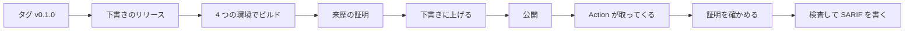

# 0017. Action は、Releases に置いたビルド済みのバイナリを、来歴の証明を確かめてから取ってくる composite Action にする

- ステータス: 承認
- 日付: 2026-11-13

## 文脈

- ADR 0001 は、CLI と GitHub Action の両方で配ると決めた。ADR 0016 で SARIF を出せるようになり、`upload-sarif` でコードスキャンに載せられる
- sekimori はワークフローの安全性を検査する道具なので、配る仕組みそのものが、取ってくるものを確かめられる形である必要がある
- 配り方の候補(2026-11-13 に確かめた)
  - GitHub Releases にビルド済みのバイナリを置く。リリースは後から消せる
  - crates.io に公開する。出した版は消せず、yank で新しい依存から外せるだけ
  - Action の中で、毎回ソースからビルドする。依存のクレートを毎回取ってきてビルドするので、1 回に数分かかる
- 同じ種類の道具の zizmor は、Docker のイメージを ghcr.io に置き、composite Action の zizmor-action が `docker run` で動かす。Docker は Linux のランナーでしか動かない
- GitHub の artifact attestations(actions/attest、2026-11-13 に v4.2.2 の action.yml と README で確かめた)
  - ビルドしたファイルに、どのリポジトリのどのワークフローのどの ref でビルドしたかの来歴(SLSA build provenance)を署名して付ける。公開リポジトリでは Sigstore の公開のインスタンスで署名し、どの GitHub のプランでも使える
  - `id-token: write` と `attestations: write` の権限が要る。`artifact-metadata: write` はコンテナのレジストリに記録を書くときだけ要る
  - 確かめる側は、`gh attestation verify` に `--repo`、`--signer-workflow`、`--source-ref` を渡して、署名したワークフローと ref まで縛れる。gh はどのランナーにも入っている
- 高橋さんは、選択肢を出したところ「推奨のやり方でお願い」と答え、公開まで進めることを認めた(2026-11-13)

## 検討した選択肢

1. タグを押すと、ワークフローが 4 つの環境のバイナリをビルドし、来歴の証明を付けて Releases に置く。Action は composite で、ランナーに合うバイナリを取ってきて、証明を確かめてから動かす
2. 1 と同じで、証明の代わりに SHA-256 の一覧をリリースに置いて照らす
3. crates.io に公開し、Action は `cargo install` で入れる
4. Action の中で、毎回ソースからビルドする

## 決定

高橋さんが判断を任せ(2026-11-12 に「承認取らなくていい」、2026-11-13 に「推奨のやり方でお願い」)、Claude が 1 を選んだ。crates.io への公開は、今回はしない。

リリースのワークフロー(`.github/workflows/release.yml`)

- `v` で始まるタグを押すと動く。ワークフロー全体の権限は空にし、ジョブごとに要るものだけを与える
- 最初のジョブで、タグが `Cargo.toml` の版(`v` + 版)と一致するかを確かめ、下書きのリリースを作る
- 次のジョブで、次の 4 つの環境を並べてビルドする。Linux は musl で静的にリンクし、ランナーの glibc の版に縛られないようにする

| ランナー | ターゲット | ファイル名 |
|---|---|---|
| `ubuntu-latest` | `x86_64-unknown-linux-musl` | `sekimori-x86_64-unknown-linux-musl` |
| `ubuntu-24.04-arm` | `aarch64-unknown-linux-musl` | `sekimori-aarch64-unknown-linux-musl` |
| `macos-latest` | `aarch64-apple-darwin` | `sekimori-aarch64-apple-darwin` |
| `windows-latest` | `x86_64-pc-windows-msvc` | `sekimori-x86_64-pc-windows-msvc.exe` |

- バイナリは圧縮せずにそのまま置き、そのファイルに actions/attest で来歴の証明を付けてから、下書きに上げる
- 全てのビルドが済んでから、最後のジョブで下書きを公開する。1 つでも失敗すれば、公開されない
- 外部の Action は、checkout と actions/attest の 2 つだけにし、SHA で固定する(ADR 0008)。リリースの操作は gh で行う

Action(リポジトリの根の `action.yml`)

- composite Action にする。入力は 2 つ
  - `paths`: 検査するファイルかディレクトリを空白で区切ったもの。既定は `.github/workflows`
  - `token`: リリースを取ってきて、証明を確かめるためのトークン。既定は `github.token`
- 出力は `sarif-file`。SARIF を書いたファイルのパス
- 使うバイナリの版は、Action と同じ ref にある `Cargo.toml` の版から決める。Action を `v0.1.0` のタグ(か、その SHA)で使えば、`v0.1.0` のバイナリを使う。版を書く場所を `Cargo.toml` の 1 つに保つため
- バイナリを取ってきたら、`gh attestation verify` で、このリポジトリの release.yml が `refs/tags/v<版>` でビルドしたものかを確かめる。合わなければ動かさずに失敗する
- 平文の結果をログに出し、SARIF をランナーの一時ディレクトリに書く。終了コードは ADR 0010 のとおりで、指摘があれば失敗する
- SARIF をコードスキャンに送るのは、利用者のワークフローに任せる。`github/codeql-action/upload-sarif` のステップに `if: always()` を付けて、`sarif-file` を渡す



利用者のワークフローの例

```yaml
permissions:
  contents: read
  security-events: write
steps:
  - uses: actions/checkout@<SHA> # v7.0.1
    with:
      persist-credentials: false
  - id: sekimori
    uses: h11roki/sekimori@<SHA> # v0.1.0
  - if: always() && steps.sekimori.outputs.sarif-file != ''
    uses: github/codeql-action/upload-sarif@<SHA> # v4.39.3
    with:
      sarif_file: ${{ steps.sekimori.outputs.sarif-file }}
```

## 理由

- ビルド済みのバイナリなら、Action は数秒で始まる。毎回ビルドすると数分かかり、エージェントのワークフローを持つリポジトリの CI が遅くなる(選択肢 4)
- 来歴の証明は、どのワークフローがどのタグでビルドしたかまで確かめられる。SHA-256 の一覧は、同じリリースに置くので、リリースを書き換えられる人には一覧ごと書き換えられる(選択肢 2)
- crates.io は出した版を消せない。まだ利用者がいない最初の版で、取り消せない公開をする理由が無い(選択肢 3)。Releases は、問題があれば消して出し直せる
- Docker のイメージは Linux のランナーでしか動かず、レジストリも 1 つ増える。バイナリなら macOS と Windows のランナーでも動く
- composite Action の手順はシェルだけで、Node の Action のように依存のパッケージを抱えない。検査する道具自身の供給網を小さく保てる
- SARIF を送る手順を Action に入れると、codeql-action の版を sekimori が追うことになる。利用者が自分で固定する方が、更新を Dependabot に任せられる

## 受け入れたトレードオフ

- `cargo install sekimori` では入れられない。手元で使うには、Releases からバイナリを取ってくるか、ソースからビルドする
- Intel の macOS と ARM の Windows のランナーでは動かない。対応の無い環境では、エラーで止める
- Action を main のような、まだリリースしていない版の ref で使うと、`Cargo.toml` の版のリリースが無いか、古いバイナリを使う
- 平文と SARIF を出すために、検査を 2 回走らせる。ワークフローのファイルは数十なので、時間は問題にならない
- 証明を確かめるのに、トークンと GitHub の API への接続が要る。GitHub Enterprise Server では、github.com のリリースを取ってこられないことがある
- リリースのワークフローが失敗すると、下書きとタグが残る。消してから、タグを押し直す

## 再検討する条件

- 利用者から、`cargo install` で入れたいと求められたとき
- 対応していないランナーで使いたいと求められたとき
- GitHub が、Action の配布に別の仕組み(Immutable Actions など)を広く出したとき
